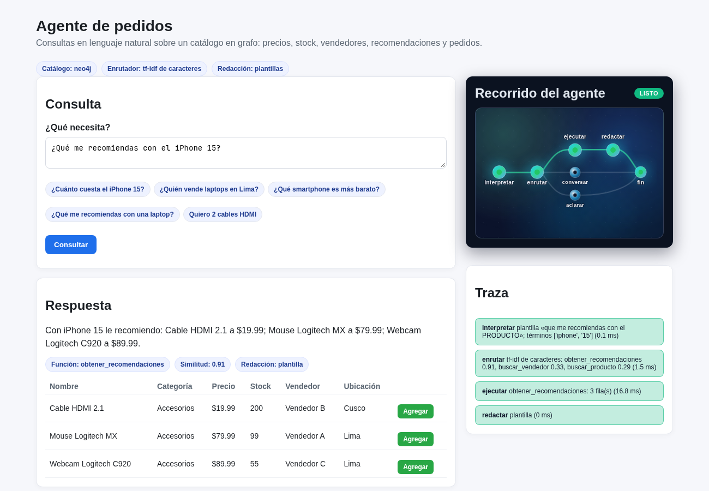

# agente-pedidos-neo4j

[](https://github.com/Whiteherobot/agente-pedidos-neo4j/actions/workflows/ci.yml)

Agente que responde consultas en lenguaje natural sobre una tienda de tecnología
guardada como grafo en Neo4j: precios, stock, comparaciones, vendedores,
productos por ciudad, recomendaciones y pedidos. Proyecto final de Inteligencia
Artificial (febrero de 2026).



## Cómo funciona

```
consulta ──> interpretar ──> enrutar ──┬─> ejecutar ──> redactar ──> respuesta
             (entidades)    (similitud) ├─> conversar   (saludos)
                                        └─> aclarar     (similitud < 0,3)
```

El flujo es un grafo de **LangGraph** y cada nodo deja un paso en la traza que
muestra la página.

1. **Interpretar.** Se extraen los términos de producto, la categoría, la
   ciudad y la cantidad ("quiero **2** iPhone 14" → cantidad 2; "iPhone **14**"
   → modelo). La consulta se convierte en una plantilla con marcadores
   (`quiero NUM PRODUCTO`), para que la forma de la pregunta pese más que el
   producto que nombra.
2. **Enrutar.** La plantilla se compara por similitud coseno con los ejemplos
   de la [tabla de funciones](agente/funciones.py) (8 funciones + saludo). Por
   defecto con TF-IDF de n-gramas de caracteres; con `AGENTE_EMBEDDINGS=1` y
   `sentence-transformers` instalado, con embeddings multilingües. Acierta 33 de
   33 preguntas que no están en los ejemplos (`tests/consultas_etiquetadas.py`).
3. **Ejecutar.** La función corre contra el catálogo: Cypher sobre Neo4j o la
   versión en memoria, que cumplen el mismo contrato y pasan las mismas pruebas.
4. **Redactar.** La respuesta se arma con plantillas a partir de los datos. Con
   `GEMINI_API_KEY`, Gemini la reescribe usando solo esos datos; si falla, queda
   la de la plantilla.

### El grafo

```
(:Producto)-[:VENDIDO_POR]->(:Vendedor)-[:UBICADO_EN]->(:Ciudad)
(:Producto)-[:EN_CATEGORIA]->(:Categoria)
(:Producto)-[:ALMACENADO_EN]->(:Ciudad)
(:Pedido)-[:INCLUYE {cantidad, precio_unitario}]->(:Producto)
```

Las recomendaciones salen primero de lo que otros compraron junto
(`Pedido-INCLUYE->Producto`) y después de categorías complementarias, empezando
por el mismo vendedor.

### Pedidos

El chat solo propone la línea del carrito; el pedido se confirma desde la
página. La API recibe producto y cantidad, y el precio lo pone el catálogo. En
Neo4j el pedido es una transacción: si algún producto no tiene stock suficiente
no se descuenta nada (409), y el descuento es condicional, así que dos pedidos
simultáneos no venden de más.

## Cómo correrlo

```bash
docker compose up -d --build     # http://localhost:8000  (Neo4j Browser en :7474)
```

Sin Docker, con el catálogo en memoria:

```bash
python -m venv .venv && source .venv/bin/activate
pip install -r requirements.txt
uvicorn api.main:crear_app --factory --reload
```

Para usar un Neo4j propio, copiar `.env.example` a `.env` y completar
`NEO4J_URI`, `NEO4J_USER` y `NEO4J_PASSWORD`. La API carga el grafo si está
vacío; `python scripts/cargar_neo4j.py` lo reinicia.

| Método | Ruta | |
|---|---|---|
| POST | `/api/consulta` | `{"consulta": "¿Cuánto cuesta el iPhone 14?"}` → función, similitud, respuesta, filas, carrito propuesto y traza. |
| GET | `/api/productos` | Catálogo con stock actual. |
| POST | `/api/pedidos` | `{"cliente": "Ana", "items": [{"producto_id": 2, "cantidad": 1}]}` |
| GET | `/api/pedidos` | Pedidos, del más nuevo al más viejo. |
| GET | `/api/estado` | Catálogo, enrutador y redacción en uso. |

Un enlace como `http://localhost:8000/?consulta=Quiero%202%20cables%20HDMI`
abre la página con esa consulta hecha.

## Pruebas

```bash
pip install -r requirements-dev.txt
pytest                                   # catálogo en memoria
NEO4J_URI=bolt://localhost:7687 NEO4J_PASSWORD=... pytest   # además, contra Neo4j
```

51 pruebas: el contrato del catálogo en los dos motores (búsqueda, filtros,
vendedores, pedidos atómicos, 12 compras simultáneas por 8 unidades,
recomendaciones), la extracción de entidades, el enrutamiento, las respuestas
del agente y la API. La CI corre todo contra Neo4j, ejecuta el cuaderno y
prueba el `docker compose`.

## Cuadernos

- `notebooks/pipeline_agente.ipynb`: el pipeline paso a paso con el mismo
  código de la API.
- `notebooks/kg_query_pipeline.ipynb`: ejercicio aparte de la materia, un grafo
  de conocimiento pequeño en networkx (Tesla, SpaceX) con búsqueda de caminos.
  Preguntas de prueba en `notebooks/preguntas_grafo_tesla.md`.

## De dónde sale

En 2026 se revisó el proyecto (antes `final`). La versión original decía
consultar Neo4j pero respondía todo desde pandas (las consultas Cypher no se
ejecutaban), una lista de palabras clave pisaba siempre la elección por
embeddings y la reportaba con similitud 1.0, "clientes" contaba productos,
vendedores y stock ignoraban la pregunta, y los pedidos aceptaban el precio que
mandaba el navegador sin descontar stock. Se rehízo con la misma idea:
tabla de funciones, enrutamiento por similitud, LangGraph, Neo4j y LLM para la
respuesta.

## Autor

Michael Lata ([@Whiteherobot](https://github.com/Whiteherobot))

Licencia MIT.
